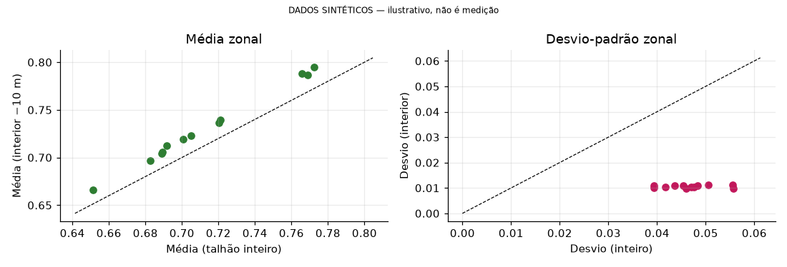
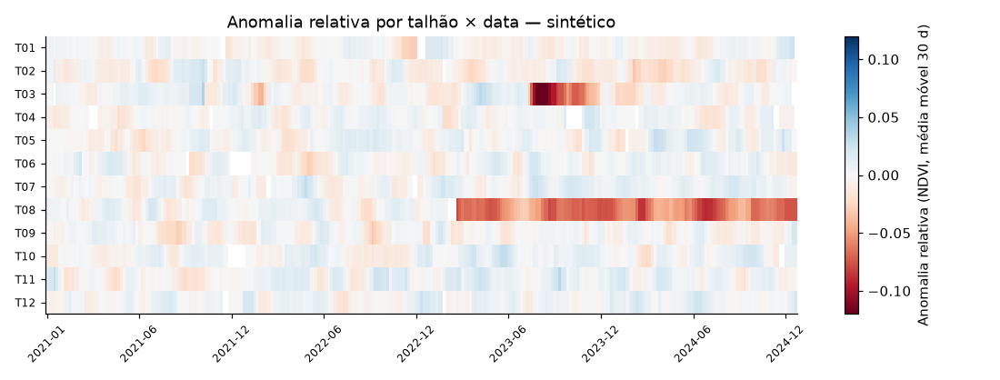

# AgroGeo Analytics

Geospatial data science workflow for agriculture, applied to coffee growing in Piraju, São Paulo (Brazil): GIS operations on field plots, Sentinel-2 spectral indices (NDVI, NDRE), zonal statistics, time series with anomalies and interactive maps. [Versão em português](README.md)

> **Synthetic data.** The plots (*talhões*), the NDVI/NDRE series and the raster in `data/sample/` are synthetic (fixed seed, labelled in files, columns and plots) and are not empirical results. The Piraju municipal boundary and its neighbours are real (IBGE).
>
> NDVI/NDRE do not diagnose diseases, pests or deficiencies; they reflect reflectance and only yield hypotheses to be checked in the field.

The technical guide ([docs/GUIA_TECNICO.md](docs/GUIA_TECNICO.md)) is written in Brazilian Portuguese.

## Features

- GIS operations in a metric CRS: area, buffers (including negative), compactness, intersections.
- NDVI and NDRE with SCL cloud masking (Sentinel-2 SR Harmonized).
- Raster zonal statistics, edge effects and plot comparison.
- Time series: gaps, climatology, temporal and relative anomalies, robust z-score, limited interpolation.
- Interactive maps (folium) and GeoJSON/HTML export.
- Optional Google Earth Engine and MapBiomas integration for real data.

## Example outputs (synthetic data)




## Architecture

```
data/sample/ --> src/agrogeo/ --> notebooks/ (01..06) --> outputs/ (figures, HTML maps, GeoJSON)
                     ^
scripts/ ------------+   IBGE download, synthetic data, Earth Engine/MapBiomas export, notebook build/run
```

Modules in `src/agrogeo/`: `gis`, `indices`, `zonal`, `timeseries`, `maps`, `ee_utils`, `synthetic`, `config`.

## Quick start

Requires Python 3.10 or later.

```bash
python3 -m venv .venv && source .venv/bin/activate      # Windows: .venv\Scripts\activate
pip install -r requirements.txt
pip install -e .
pytest -q
jupyter lab notebooks/                                   # or: python scripts/run_notebooks.py
```

Notebooks run offline on the data in `data/sample/`. Data reproduction and Earth Engine setup: [technical guide](docs/GUIA_TECNICO.md) (Portuguese).

## Notebooks

| Notebook | Topic |
|---|---|
| [01_fundamentos_gis](notebooks/01_fundamentos_gis.ipynb) | CRS/EPSG, geometry, reprojection, area, buffers, intersections |
| [02_dados_satellite](notebooks/02_dados_satellite.ipynb) | Sentinel-2, SCL mask, temporal composites, NDVI and NDRE |
| [03_analise_talhoes](notebooks/03_analise_talhoes.ipynb) | zonal statistics, edge effects, plot comparison |
| [04_series_temporais](notebooks/04_series_temporais.ipynb) | gaps, seasonality, temporal and relative anomalies |
| [05_mapas_interativos](notebooks/05_mapas_interativos.ipynb) | folium maps, raster overlay, GeoJSON/HTML export |
| [06_insights_agricolas](notebooks/06_insights_agricolas.ipynb) | interpretation, limitations, agronomic hypotheses, MapBiomas |

## Repository structure

```
src/agrogeo/     Python package
tests/           pytest tests
scripts/         IBGE download, sample data, Earth Engine/MapBiomas export, notebook build/run
notebooks/       executed notebooks
data/sample/     small data: IBGE boundaries (real) and plots/series/raster (synthetic)
outputs/         figures, HTML maps and GeoJSON produced by the notebooks
docs/            technical guide
```

## Tests

```bash
pytest -q
```

They cover `gis`, `indices`, `zonal`, `timeseries`, `synthetic`, `maps` and the Earth Engine result conversion. Code that talks to Earth Engine has no automated test against the live service.

## Data and licences

- **Sentinel-2 SR Harmonized** (`COPERNICUS/S2_SR_HARMONIZED`, Earth Engine): Copernicus Sentinel Data Terms and Conditions.
- **MapBiomas Brazil** (`projects/mapbiomas-public/assets/brazil/lulc/v1`, 30 m): CC-BY-4.0 per the catalog; class 46 = Coffee.
- **IBGE**: municipal boundaries (Malhas API v3); Piraju = 3538808.
- **Plots**: user-provided GeoJSON; otherwise synthetic.

Provenance, synthetic-data parameters and attributions: [technical guide](docs/GUIA_TECNICO.md#3-fontes-de-dados-e-proveniência).

## Licence

GPL-3.0. See [LICENSE](LICENSE).
