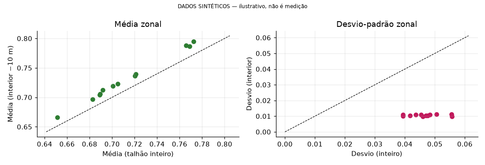
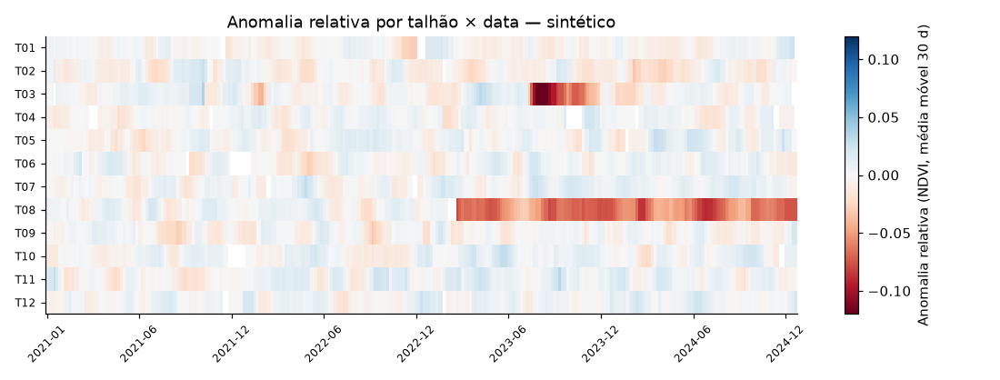

# AgroGeo Analytics

Fluxo de ciência de dados geoespacial para agricultura, aplicado à cafeicultura em Piraju/SP: operações GIS sobre talhões, índices espectrais (NDVI, NDRE) do Sentinel-2, estatísticas zonais, séries temporais com anomalias e mapas interativos. [English version](README.en.md)

> **Dados sintéticos.** Os talhões, a série NDVI/NDRE e o raster em `data/sample/` são sintéticos (semente fixa, identificados em arquivos, colunas e gráficos) e não constituem resultados empíricos. O limite municipal de Piraju e vizinhos é real (IBGE).
>
> NDVI/NDRE não diagnosticam doenças, pragas ou deficiências; indicam reflectância e geram hipóteses a verificar em campo.

## Funcionalidades

- Operações GIS em CRS métrico: área, buffers (inclusive negativos), compacidade, interseções.
- NDVI e NDRE com máscara de nuvens por SCL (Sentinel-2 SR Harmonized).
- Estatísticas zonais sobre raster, efeito de borda e comparação entre talhões.
- Séries temporais: lacunas, climatologia, anomalia temporal e relativa, z-score robusto, interpolação limitada.
- Mapas interativos (folium) e exportação GeoJSON/HTML.
- Integração opcional com Google Earth Engine e MapBiomas para dados reais.

## Resultados de exemplo (dados sintéticos)




## Arquitetura

```
data/sample/ --> src/agrogeo/ --> notebooks/ (01..06) --> outputs/ (figuras, mapas HTML, GeoJSON)
                     ^
scripts/ ------------+   download IBGE, dados sintéticos, export Earth Engine/MapBiomas, build/run dos notebooks
```

Módulos de `src/agrogeo/`: `gis`, `indices`, `zonal`, `timeseries`, `maps`, `ee_utils`, `synthetic`, `config`.

## Início rápido

Requer Python 3.10 ou superior.

```bash
python3 -m venv .venv && source .venv/bin/activate      # Windows: .venv\Scripts\activate
pip install -r requirements.txt
pip install -e .
pytest -q
jupyter lab notebooks/                                   # ou: python scripts/run_notebooks.py
```

Os notebooks rodam offline com os dados de `data/sample/`. Reprodução dos dados e configuração do Earth Engine: [guia técnico](docs/GUIA_TECNICO.md).

## Notebooks

| Notebook | Conteúdo |
|---|---|
| [01_fundamentos_gis](notebooks/01_fundamentos_gis.ipynb) | CRS/EPSG, geometria, reprojeção, área, buffers, interseções |
| [02_dados_satellite](notebooks/02_dados_satellite.ipynb) | Sentinel-2, máscara SCL, composições temporais, NDVI e NDRE |
| [03_analise_talhoes](notebooks/03_analise_talhoes.ipynb) | estatísticas zonais, efeito de borda, comparação entre talhões |
| [04_series_temporais](notebooks/04_series_temporais.ipynb) | lacunas, sazonalidade, anomalia temporal e relativa |
| [05_mapas_interativos](notebooks/05_mapas_interativos.ipynb) | mapas folium, raster sobreposto, exportação GeoJSON/HTML |
| [06_insights_agricolas](notebooks/06_insights_agricolas.ipynb) | interpretação, limitações, hipóteses agronômicas, MapBiomas |

## Estrutura do repositório

```
src/agrogeo/     pacote Python
tests/           testes pytest
scripts/         download IBGE, dados de exemplo, export Earth Engine/MapBiomas, build/run dos notebooks
notebooks/       notebooks executados
data/sample/     dados pequenos: malha IBGE (real) e talhões/série/raster (sintéticos)
outputs/         figuras, mapas HTML e GeoJSON gerados pelos notebooks
docs/            guia técnico
```

## Testes

```bash
pytest -q
```

Cobrem `gis`, `indices`, `zonal`, `timeseries`, `synthetic`, `maps` e a conversão de resultados do Earth Engine. O código que se comunica com o Earth Engine não possui teste automatizado contra o serviço real.

## Dados e licenças

- **Sentinel-2 SR Harmonized** (`COPERNICUS/S2_SR_HARMONIZED`, Earth Engine): Copernicus Sentinel Data Terms and Conditions.
- **MapBiomas Brasil** (`projects/mapbiomas-public/assets/brazil/lulc/v1`, 30 m): CC-BY-4.0 conforme o catálogo; classe 46 = Café.
- **IBGE**: malhas municipais (API de Malhas v3); Piraju = 3538808.
- **Talhões**: GeoJSON do usuário; na ausência, sintéticos.

Proveniência, parâmetros dos dados sintéticos e atribuições: [guia técnico](docs/GUIA_TECNICO.md#3-fontes-de-dados-e-proveniência).

## Documentação

[Guia técnico](docs/GUIA_TECNICO.md): arquitetura, dados, instalação, reprodução, metodologia, testes, limitações e solução de problemas.

## Licença

GPL-3.0. Consulte o arquivo [LICENSE](LICENSE).
